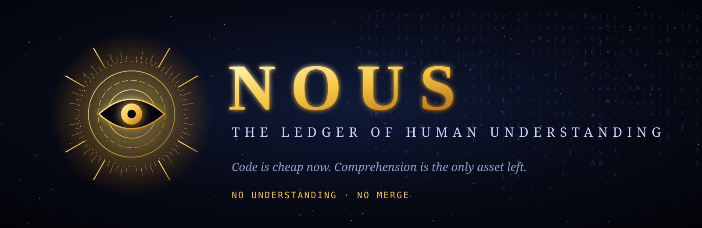
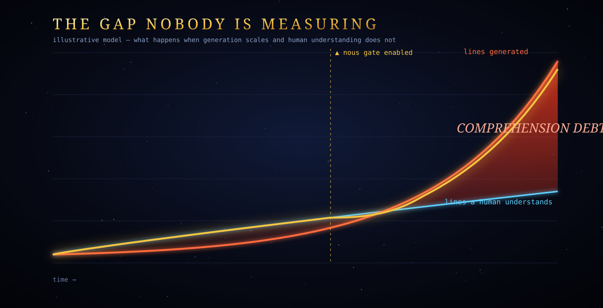
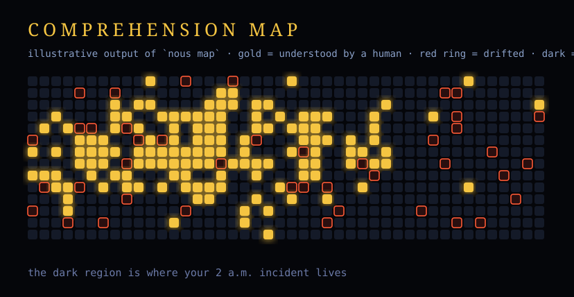
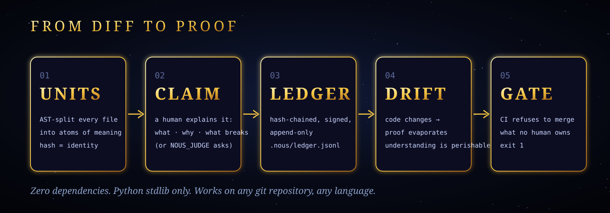
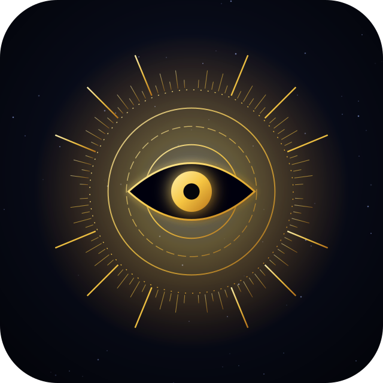

  

<h3 align="center">Code is cheap now. Comprehension is the only asset left.</h3>

  
  
  

---

## The problem nobody is measuring

AI writes code faster than any human can read it. Tests pass. Linters are green.
**And nobody on your team can explain what is running in production.**

That gap has a name: *comprehension debt*. Unlike technical debt, it is invisible
until 2 a.m., when something breaks and no living person knows why.

## NOUS makes understanding a first-class, enforceable artifact
 alt="python">
  
  

---

## The problem nobody is measuring

AI writes code faster than any human can read it. Tests pass. Linters are green.
**And nobody on your team can explain what is running in production.**

That gap has a nam

## How it works

1.set left.</hEvery file is split into atoms (functions, methods, blocks). Identity = hash of normalized text.
2.0%">

<A human explains what it does, why, and what breaks it. Vague stamps ("lgtm") are rejected.
3.h="100%">
</pEntries are append-only, hash-chained, optionally HMAC-signed (`NOUS_KEY`). Rewrite history and="100%">

pinpoints the break.
4.mg src="bannEdit a unit and its proof dies. Move it and the proof survives.
5.of human unCI fails on low global coverage, on critical paths below their bar, or on any unit *this PR* introduced that no human vouched for.

## Plug in a harder interrogator
the only asset left.</h3>

  

<b>NO UNDERSTANDING · NO MERGE</b>

